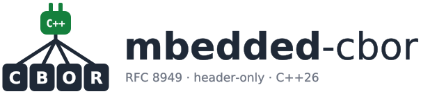

<h1 align="center">
  <picture>
    <source media="(prefers-color-scheme: dark)" srcset="assets/logo-dark.svg">
    
  </picture>
</h1>

<p align="center">
  <b>Fast, header-only CBOR for C++23 and C++26, from microcontrollers to servers,
  made to be embedded in devices and in other languages.</b>
</p>

<p align="center">
  
  
  <a href="https://www.rfc-editor.org/rfc/rfc8949"></a>
  <a href="LICENSE"></a>
  <a href="https://asmod4n.github.io/mbedded-cbor-docs/"></a>
</p>

<p align="center">
  <a href="https://asmod4n.github.io/mbedded-cbor-docs/">Documentation</a> ·
  <a href="#examples">Examples</a> ·
  <a href="#performance">Performance</a> ·
  <a href="#integration">Integration</a>
</p>

Describe a struct in one line, write it, and read one field without decoding
the rest:

```cpp
struct point {
    float x;
    float y;
};

struct track {
    std::vector<point> points;
};

CBOR_DEFINE_TYPE_MEMBERS(point, cbor::tag{1703}, x, y);
CBOR_DEFINE_TYPE_MEMBERS(track, cbor::tag{1704}, points);

auto message = cbor::schema<track>::encode(track{{{1, 2}, {3, 4}, {5, 6}}});
auto const lane = cbor::schema<track>::adopt(std::move(*message));

lane->at_path<"$.points[2].x">();                                   // 5: one jump to the field

auto const points = lane->at_path<"$.points">();
for (auto const p : *points | std::views::drop(1) | std::views::take(1))
    use(*p.at_path<"@.y">());                                       // 4
```

Every call that can fail returns a `std::expected`.

## Features

- **Lazy** - `cbor::lazy` and `cbor::at_path` read only the items you ask for
  and skip the rest by their length.
- **Zero-copy** - a text comes back as a view into the message.
- **Structs** - `cbor::structs<T>` decodes into your struct or class;
  `cbor::encode` writes it.
- **Fixed offsets** - `cbor::schema<T>` lays out a struct at compile time
  (Packed CBOR), so a read of a fixed-size field is one jump.
- **Raw arrays** - a list of numbers, or of structs with fixed-size fields, is
  one block of little-endian bytes that is checked once.
- **Paths** - RFC 9535 paths, checked at compile time: `at_path<"$.user.id">`.
- **Errors as values** - bad input gives a `std::expected` with a `cbor::error`.
- **Standard CBOR out** - tinycbor, libcbor, jsoncons, nlohmann::json, cbor2 and
  CBOR::XS read every message that the tests write.

## Which API for which work

| You want | Use | You get |
|---|---|---|
| the whole message, no schema | `cbor::decode` | a tree of items |
| the whole message as your type | `cbor::structs<T>` | your struct, with views into the bytes |
| a few values of a large message | `cbor::lazy`, `cbor::at_path` | the values; the rest is skipped by length |
| many reads of fixed-size fields | `cbor::schema<T>` | a jump to an offset the compiler knows |
| to write anything | `cbor::encode` | the bytes of a value, a tree or a described struct |

## Examples

### Decode and encode a whole message

```cpp
// bytes: a std::string with {"sensor": "t1", "value": 21.5}
auto const tree = cbor::decode(bytes).value();

auto const pairs = tree->pairs().value();
for (auto const [key, value] : pairs)
    std::println("{}", *key.get<std::string_view>());              // sensor, value

std::string out;
cbor::encode(out, *tree);                                           // out == bytes
```

### Encode a value or a struct

```cpp
struct reading {
    std::string sensor;
    double value;
    std::vector<int> samples;
};
CBOR_DEFINE_TYPE_MEMBERS(reading, cbor::untagged, sensor, value, samples);

auto const bytes = cbor::encode(reading{"t1", 21.5, {3, 4, 5}}).value();
auto const back = cbor::structs<reading>::decode(std::string(bytes)).value();
back->sensor;                                                       // "t1"

cbor::encode(42);                                                   // 18 2a
cbor::encode(std::map<std::string, int>{{"a", 1}});                 // {"a": 1}
```

### Read a message

```cpp
// bytes: a std::string with {"sensor": "t1", "value": 21.5, "samples": [3, 4, 5]}
auto const doc = cbor::lazy::adopt(std::move(bytes)).value();

int sum = 0;
if (auto const samples = doc.at("samples")) {
    auto const elements = samples->elements().value();
    for (auto const &x : elements)
        if (x)
            sum += x->get<int>().value_or(0);   // 12
}
```

### Read one value by its path

```cpp
// owner: a std::shared_ptr<std::string const> with {"user": {"id": 42, "name": "ann"}}
auto const doc = cbor::lazy::view(owner).value();

auto const id = doc.at_path<"$.user.id", std::int64_t>();          // 42
auto const name = doc.at_path<"$.user.name", std::string_view>();  // "ann", a view into the message
auto const age = doc.at_path<"$.user.age", int>();                 // cbor::error::key_not_found
```

## How a read works



A path compares the keys it meets, skips every other value by the length in its
head, and stops at the value.



With `cbor::schema`, the struct is the layout: the compiler knows the offset of
each field, so the read is one jump.



A vector of fixed-size structs is checked once. Then element `i` is at
`i × sizeof(element)`.

## Performance

Read one field (`cars[500].engine.cc`) of the carsales message of 1000 cars. The
number says how many times faster mbedded-cbor is than the library beside it.

| mbedded-cbor | Library beside it | g++ 16 | clang 23 |
|---|---|---|---|
| `lazy` | tinycbor | 6.6× | 5.1× |
| `at_path` | jsoncons JSONPath | 50× | 47× |
| `item` | jsoncons `json` | 3.2× | 4.1× |
| `structs` | jsoncons `decode_cbor<T>` | 8.6× | 13× |
| `schema`, unverified | FlatBuffers without Verifier | 0.40× | 0.27× |

`schema`, unverified checks every bound and FlatBuffers without its Verifier
checks none, so FlatBuffers is faster here. Where both check the whole message,
a read of the whole message by `schema` takes the time of FlatBuffers with its
Verifier divided by 1.3 (g++ 16) or 1.5 (clang 23).

Intel Xeon (Sapphire Rapids) VM with 4 cpus, Debian sid, `-O2 -march=native`,
median of 5 runs, at commit cb28a52. The tables for the whole message and for
writing, the notes and the method are in [bench/README.md](bench/README.md#kinds-tablesh);
the code of each library, task by task, is in [bench/comparison.md](bench/comparison.md).

## Standards

| Specification | In the library |
|---|---|
| [RFC 8949](https://www.rfc-editor.org/rfc/rfc8949) CBOR | decode, encode, diagnostic notation |
| [RFC 8742](https://www.rfc-editor.org/rfc/rfc8742) CBOR sequences | `cbor::sequence_reader` |
| [RFC 8746](https://www.rfc-editor.org/rfc/rfc8746) typed arrays | tags 64 to 87 as raw blocks of numbers |
| [RFC 8943](https://www.rfc-editor.org/rfc/rfc8943) dates | tags 100 and 1004 |
| [RFC 9581](https://www.rfc-editor.org/rfc/rfc9581) extended time | tags 1001 and 1002 |
| [RFC 9535](https://www.rfc-editor.org/rfc/rfc9535) JSONPath | `at_path` |
| [draft-ietf-cbor-packed-19](https://datatracker.ietf.org/doc/draft-ietf-cbor-packed/19/) Packed CBOR | `cbor::schema`, `cbor::static_dictionary` |

### Validity checks

RFC 8949 section 10 asks a generic decoder to state its checks:

- **Well-formed.** Each reader accepts well-formed CBOR (RFC 8949 section 3 and
  Appendix F). `cbor::decode` and `cbor::structs` stop at the first fault with
  the error; `cbor::lazy` gives a fault when a call reaches it.
- **Definite length.** The readers take definite lengths and give
  `indefinite_length` for an indefinite one (RFC 8949 section 5.1);
  `cbor::diagnostic_notation` writes it as it stands.
- **Tag content.** Tags 2 and 3 take a byte string, tag 24 a byte string that
  holds one item, tag 29 an unsigned integer, and tags 64 to 87 a byte string;
  other content gives `inadmissible_type_for_tag_content`.
- **Cycles.** `cbor::decode_cycles` resolves tags 28 and 29 for cycles. A tag 29
  names an item that a tag 28 marked before it and whose decode is open; else
  the read gives `sharedref_not_cyclic`, `sharedref_not_defined` or
  `sharedref_index_not_marked`.
- **Duplicate keys.** `cbor::decode` keeps every entry, `cbor::structs` gives
  `duplicate_key` (an unordered multimap appends the values), and `cbor::lazy`
  gives the first match.
- **UTF-8.** The application checks text strings with the UTF-8 check of its
  choice.
- **Limits.** A reader that recurses stops where the stack of its thread ends.
  String length and element count are constants of the build, and memory grows
  with the items that were read.

## Supported compilers

| Compiler | Standard | System |
|---|---|---|
| g++ 16 | C++26 with `-freflection` | Linux |
| g++ 15, clang 21 | C++23 | Linux (glibc, musl) |
| AppleClang of Xcode 26 | C++23 | macOS 26 |
| clang-cl of Visual Studio | C++23 | Windows x64 |

It also builds for WebAssembly without threads and for picolibc. In C++23,
`cbor::structs` reads the members through Boost.PFR 1.84 or later; a copy is in
`third_party/boost_pfr`. With C++26 reflection, `cbor::schema` also checks each
description against the members of the struct.

## Integration

The library is header-only. Add `include/` to the include path of your build:

```sh
g++-16 -std=c++26 -freflection -I mbedded-cbor/include app.cpp
clang++ -std=c++23 -I mbedded-cbor/include -I mbedded-cbor/third_party/boost_pfr/include app.cpp
```

```cpp
#include <cbor/cbor.hpp>
```

With CMake, install it and find it:

```sh
cmake -S mbedded-cbor -B build -DBUILD_TESTING=OFF
cmake --install build --prefix /usr/local
```

```cmake
find_package(mbedded-cbor 0.9 CONFIG REQUIRED)
target_link_libraries(app PRIVATE mbedded-cbor::mbedded-cbor)
```

Or take it with FetchContent:

```cmake
include(FetchContent)
FetchContent_Declare(mbedded-cbor
    GIT_REPOSITORY https://github.com/Asmod4n/mbedded-cbor
    GIT_TAG main)
FetchContent_MakeAvailable(mbedded-cbor)
```

## Documentation

- [asmod4n.github.io/mbedded-cbor-docs](https://asmod4n.github.io/mbedded-cbor-docs/):
  every function and type, with examples that run in the browser.
- The comments of the headers in `include/cbor/`. The site and the man pages are
  made from them in [Asmod4n/mbedded-cbor-docs](https://github.com/Asmod4n/mbedded-cbor-docs).

## Testing

The tests run the examples of RFC 8949 Appendix A, the test vectors of the IETF
CBOR working group and the JSONPath Compliance Test Suite, with
AddressSanitizer and UndefinedBehaviorSanitizer, and other decoders read the
output. Fuzz targets cover decode, diagnostic notation, item_size, lazy, path,
sequence_reader, structs and schema.

**Status:** version 0.9, before the first release. The API can still change.

## License

Apache License 2.0, see [LICENSE](LICENSE). The JSON reader of
`cbor::parse_edn` is ported from yyjson (MIT), see [NOTICE](NOTICE).
