# mbedded-cbor

A fast C++ library for CBOR (RFC 8949) that follows the specifications,
for microcontrollers and for large servers. It does more than decode a
whole message and encode it again without a schema:

- **Lazy decode.** `cbor::lazy` and `cbor::at_path` read only the items
  that you ask for, and skip the rest by their length.
- **Structs and classes.** `cbor::structs` decodes CBOR into a struct or
  a class, and encodes it again.
- **Schema encode with Packed CBOR** (draft-ietf-cbor-packed-19).
  `cbor::schema` lays out a struct at compile time. A list of structs
  whose fields all have a fixed width is written with one copy.
- **The whole message.** `cbor::decode` gives a tree of items, and
  `cbor::encode` writes it again.

The library is header-only.

```cpp
struct point {
    float x;
    float y;
};

struct track {
    std::vector<point> points;
};

CBOR_DEFINE_TYPE_MEMBERS(point, cbor::tag{1703}, x, y);
CBOR_DEFINE_TYPE_MEMBERS(track, cbor::tag{1704}, points);

auto message = cbor::schema<track>::encode(track{{{1, 2}, {3, 4}, {5, 6}}});
auto const lane = cbor::schema<track>::path(std::move(*message));

lane->at_path<"$.points[2].x">();                                   // 5: one jump to the field

auto const points = lane->at_path<"$.points">();
for (auto const p : *points | std::views::drop(1) | std::views::take(1))
    use(*p.at_path<"@.y">());                                       // 4
```

The reference with examples that run in the browser:
<https://asmod4n.github.io/mbedded-cbor/>.

It implements CBOR (RFC 8949), CBOR sequences (RFC 8742), typed arrays
(RFC 8746), JSONPath (RFC 9535) and Packed CBOR
(draft-ietf-cbor-packed-19). Every message it writes is standard CBOR,
and every other CBOR decoder can read it.

## Features

- **Reads in place.** A text comes back as a view into
  the message.
- **Reads only what you ask for.** A path reads the heads of the items on
  its way and skips the rest by their length.
- **Fixed offsets.** `cbor::schema` lays out a struct at compile time,
  from the tag and the members that `cbor::describe_members` gives. A
  read of a field of fixed size is one jump.
- **Raw arrays.** A list of numbers, and a list of structs whose fields
  all have a fixed width, is one block of little-endian bytes. The block
  is checked once.
- **Errors as values.** Bad input gives a `std::expected` with a
  `cbor::error`. A read gives every fault of the input as a value.
- **One description, every compiler.** `cbor::schema` reads only
  `cbor::describe_members` and builds in C++23. With C++26 reflection it
  also checks each description against the members of the struct.
  `CBOR_DEFINE_TYPE_MEMBERS` writes a description from the names of the
  members in one line.
- **Trusted peers.** The `unverified_` forms of `cbor::schema` skip the
  checks of the data and keep every check of a bound.
- **Description apart.** `cbor::schema` can store the description of a
  struct once and the data of each message apart from it.
- **Limits.** Nesting depth, string length and element count are
  constants of the build. Memory grows with the items that were read.

## How a read works



A path compares the keys it meets. It skips every other value by the
length in its head, and it stops at the value.



With `cbor::schema`, the struct is the layout. The offset of a field
comes from the compiler, so the read is one jump.



A vector of fixed-size structs is checked once. After that, element `i`
is at `i × sizeof(element)`, and a loop runs over raw bytes.

## Performance

The carsales message of 1000 cars, read and written by each kind of
mbedded-cbor and by a library that does the same work. A number says how
many times faster mbedded-cbor is. A number under 1 says that the library
is faster. Every library checks its input, except where the row says so.

Read one field (`cars[500].engine.cc`):

| Kind | Library beside it | g++ 16 | clang 23 |
|---|---|---|---|
| lazy | tinycbor | 6.6× | 5.1× |
| at_path | jsoncons JSONPath | 50× | 47× |
| item | jsoncons `json` | 3.2× | 4.1× |
| structs | jsoncons `decode_cbor<T>` | 8.6× | 13× |
| schema | FlatBuffers with Verifier | 4700× | 2800× |
| schema, unverified | FlatBuffers, no Verifier | 0.40× | 0.27× |

Read the whole message:

| Kind | Library beside it | g++ 16 | clang 23 |
|---|---|---|---|
| item | jsoncons `json` | 3.2× | 4.0× |
| structs | jsoncons `decode_cbor<T>` | 8.7× | 13× |
| schema | FlatBuffers with Verifier | 1.3× | 1.5× |
| schema, unverified | FlatBuffers, no Verifier | 0.47× | 0.55× |

lazy and at_path read the values that you ask for and skip the rest.
For the whole message, use item or structs.

Write the message:

| Kind | Library beside it | g++ 16 | clang 23 |
|---|---|---|---|
| item | jsoncons `json` | 3.2× | 4.2× |
| structs | jsoncons `encode_cbor` | 4.6× | 7.9× |
| schema | FlatBuffers | 9.0× | 3.4× |

- schema reads Packed CBOR (155849 bytes). The other kinds and the
  libraries read the CBOR of `structs<T>::encode` (440957 bytes).
- item, structs and jsoncons decode the message before they read one
  field. jsoncons decodes the message before its path.
- jsoncons `decode_cbor<T>` copies each text into a `std::string`.
  structs gives views into the message.
- jsoncons writes no tags (422954 bytes).
- schema, unverified checks every bound, so no read leaves the input.
  It does not check the data (tags, heads). FlatBuffers without its
  Verifier checks no bounds.

Measured at commit cb28a52 in a VM with 4 cpus (Intel Xeon, Sapphire
Rapids), Debian sid, libstdc++ 16, `-O2 -march=native`, the median of 5
runs of 3 s. The noise of one run is up to 10 %. `bench/kinds-table.sh`
measures these tables on your machine, in the image of
`containers/debian-sid-bench.Containerfile`.
The run and its context:
[bench/results/kinds-2026-11-07-052855Z.json](bench/results/kinds-2026-11-07-052855Z.json).
The code of every library, task by task:
[doc/comparison.md](doc/comparison.md).

## Requirements

| Compiler | System | What builds |
|---|---|---|
| g++ 16, `-std=c++26 -freflection` | Linux | every part, and the check of each description against the members |
| g++ 15, clang 23, `-std=c++23` | Linux | every part in C++23 |
| AppleClang of Xcode 16 and 26 | macOS 15 | every part in C++23 |

On Windows the library builds with clang-cl, the clang frontend. The
frontend of MSVC is refused at the first include.

On g++ 15, clang 23 and AppleClang, `cbor::structs` reads the members
through Boost.PFR 1.84 or later, and `cbor::schema` uses it to check that
a description lists every member of an aggregate. It is the only
dependency.

CMake takes Boost 1.84 or later from the system, else its own copy in
`third_party/boost_pfr`. Details: [doc/basics.md](doc/basics.md), section 5.

## Installation

```sh
cmake -S mbedded-cbor -B build -DBUILD_TESTING=OFF
cmake --install build --prefix /usr/local
```

On Linux and macOS the install also writes the reference as man pages in
section 3: `man mbedded-cbor` gives the overview, and `man cbor::lazy`
gives one class.

```cmake
find_package(mbedded-cbor 0.9 CONFIG REQUIRED)
target_link_libraries(app PRIVATE mbedded-cbor::mbedded-cbor)
```

Or with FetchContent:

```cmake
include(FetchContent)
FetchContent_Declare(mbedded-cbor
    GIT_REPOSITORY https://github.com/Asmod4n/mbedded-cbor
    GIT_TAG main)
FetchContent_MakeAvailable(mbedded-cbor)
```

## Usage

### Read a message

The bytes move into the library, or the library reads them in place
through a `std::shared_ptr`. Both forms read the bytes where they are.

```cpp
// bytes: a std::string with {"sensor": "t1", "value": 21.5, "samples": [3, 4, 5]}
auto const doc = cbor::lazy::take_ownership(std::move(bytes)).value();

int sum = 0;
if (auto const samples = doc.at("samples")) {
    auto const elements = samples->elements().value();
    for (auto const &x : elements)
        if (x)
            sum += x->get<int>().value_or(0);   // 12
}
```

### Read one value by its path

```cpp
// owner: a std::shared_ptr<std::string const> with {"user": {"id": 42, "name": "ann"}}
auto const doc = cbor::lazy::view(owner).value();

auto const id = doc.at_path<"$.user.id", std::int64_t>();          // 42
auto const name = doc.at_path<"$.user.name", std::string_view>();  // "ann", a view into the message
auto const age = doc.at_path<"$.user.age", int>();                 // cbor::error::key_not_found
```

## Documentation

- <https://asmod4n.github.io/mbedded-cbor/>: every function and type,
  with examples that run in the browser.
- [doc/basics.md](doc/basics.md): errors, limits, memory, threads.
- [doc/path.md](doc/path.md): JSONPath on CBOR.
- [doc/schema.md](doc/schema.md): structs as Packed CBOR.
- [doc/structs.md](doc/structs.md): any CBOR into a struct.
- [doc/comparison.md](doc/comparison.md): other libraries, task by task.
- [doc/reference/](doc/reference/index.md): every function and type, one page each.
- [doc/man/man3/](doc/man/man3): the same reference as man pages, one page per class.

## Testing

The tests run the examples of RFC 8949 Appendix A, the test vectors of
the IETF CBOR working group and the JSONPath Compliance Test Suite.
`test/run.sh full` builds and runs them with g++ 16, g++ 15 and clang 23
(libstdc++ and libc++), with AddressSanitizer and
UndefinedBehaviorSanitizer, and runs other decoders on the output. Fuzz
targets cover decode, diagnostic notation, encode, the encoder,
item_size, lazy, path, sequence_reader, structs and schema.

## Status

Version 0.9, before the first release. The API can still change. The
fuzzing runs before the first release.

## License

Apache License 2.0. See [LICENSE](LICENSE).
