# mbedded-cbor

A header-only C++ library for CBOR. It reads a message in place, goes to
one value without decoding the rest, and writes C++ structs as Packed
CBOR with every field at an offset that the compiler knows.

```cpp
struct [[=cbor::tag(1703)]] point {
    float x;
    float y;
};

struct [[=cbor::tag(1704)]] track {
    std::vector<point> points;
};

auto message = cbor::schema<track>::encode(track{{{1, 2}, {3, 4}, {5, 6}}});
auto const lane = cbor::schema<track>::path(std::move(*message));
lane->at_path<"$.points[2].x">();   // 5: one jump to the field, no walk
```

It implements CBOR (RFC 8949), CBOR sequences (RFC 8742), typed arrays
(RFC 8746), JSONPath (RFC 9535) and Packed CBOR
(draft-ietf-cbor-packed-19). Every message it writes is standard CBOR,
and every other CBOR decoder can read it.

## Features

- **Reads in place.** No tree, no copy. A text comes back as a view into
  the message.
- **Reads only what you ask for.** A path reads the heads of the items on
  its way and skips the rest by their length.
- **Fixed offsets.** `cbor::schema` lays out a struct at compile time. A
  read of a field of fixed size is one jump.
- **Raw arrays.** A list of numbers, and a list of structs whose fields
  all have a fixed width, is one block of little-endian bytes. The block
  is checked once.
- **Errors as values.** Bad input gives a `std::expected` with a
  `cbor::error`. A read never throws on input.
- **Trusted peers.** The `unverified_` forms of `cbor::schema` skip the
  checks of the data and keep every check of a bound.
- **Description apart.** `cbor::schema` can store the description of a
  struct once and the data of each message without it.
- **Limits.** Nesting depth, string length and element count are
  constants of the build. A count in the input reserves no memory.

## How a read works



A path compares the keys it meets. It skips a value that it does not
need by the length in its head, and it touches no byte after the value.



With `cbor::schema`, the struct is the layout. The offset of a field
comes from the compiler, so the read does not walk.



A vector of fixed-size structs is checked once. After that, element `i`
is at `i × sizeof(element)`, and a loop runs over raw bytes.

## Performance

The carsales message of 1000 cars on an AMD Ryzen 9 5950X, g++ 16.2
`-O2 -march=native`, median of 7 runs. Every library checks its input.

| Task | mbedded-cbor | FlatBuffers + Verifier | Cap'n Proto |
|---|---|---|---|
| Read one field | 11.6 ns | 34.6 µs | 144 ns |
| Read the whole message | 59.4 µs | 52.8 µs | 114 µs |
| Write the message | 17.3 µs | 157 µs | 62.0 µs |

`bench/readme-table.sh` measures this table on your machine. The run
and its context:
[bench/results/readme-2026-10-19-183938Z.json](bench/results/readme-2026-10-19-183938Z.json).
The code of every library, task by task:
[doc/comparison.md](doc/comparison.md).

## Requirements

| Compiler | System | What builds |
|---|---|---|
| g++ 16, `-std=c++26 -freflection` | Linux | everything |
| g++ 15, clang 23, `-std=c++23` | Linux | everything but `cbor::schema` |
| AppleClang of Xcode 16 and 26 | macOS 15 | everything but `cbor::schema` |

`cbor::structs` uses Boost.PFR 1.84 or later where reflection is not
available. Nothing else is needed.

### Boost.PFR

CMake looks for Boost 1.84 or later on the system and uses it. If it
finds none, the library uses its own copy of Boost.PFR 1.92.0 in
`third_party/boost_pfr`, unchanged from boostorg/pfr, under the Boost
Software License 1.0. An install then places this copy in
`include/mbedded-cbor/boost_pfr`, and the CMake package and the
pkg-config file add it to the include path. The configure output says
which of the two the build takes.

Every translation unit of a program must see the same Boost.PFR. A
program that also uses another Boost.PFR of its own breaks the
one-definition rule. An older Boost.PFR that comes first on the include
path stops the build with an error that names version 1.84.

## Installation

```sh
cmake -S mbedded-cbor -B build -DBUILD_TESTING=OFF
cmake --install build --prefix /usr/local
```

```cmake
find_package(mbedded-cbor 0.9 CONFIG REQUIRED)
target_link_libraries(app PRIVATE mbedded-cbor::mbedded-cbor)
```

Or without an install:

```cmake
include(FetchContent)
FetchContent_Declare(mbedded-cbor
    GIT_REPOSITORY https://github.com/Asmod4n/mbedded-cbor
    GIT_TAG main)
FetchContent_MakeAvailable(mbedded-cbor)
```

## Usage

### Read a message

The bytes move into the library, or the library reads them in place
through a `std::shared_ptr`. Neither form copies them.

```cpp
// bytes: a std::string with {"sensor": "t1", "value": 21.5, "samples": [3, 4, 5]}
auto const doc = cbor::lazy::take_ownership(std::move(bytes)).value();

int sum = 0;
if (auto const samples = doc.at("samples")) {
    auto const elements = samples->elements().value();
    for (auto const &x : elements)
        if (x)
            sum += x->get<int>().value_or(0);   // 12
}
```

### Read one value by its path

```cpp
// owner: a std::shared_ptr<std::string const> with {"user": {"id": 42, "name": "ann"}}
auto const doc = cbor::lazy::view(owner).value();

auto const id = doc.at_path<"$.user.id", std::int64_t>();          // 42
auto const name = doc.at_path<"$.user.name", std::string_view>();  // "ann", no copy
auto const age = doc.at_path<"$.user.age", int>();                 // cbor::error::key_not_found
```

### Write structs, read one field

```cpp
struct [[=cbor::tag(1703)]] point {
    float x;
    float y;
};

struct [[=cbor::tag(1704)]] track {
    std::vector<point> points;
};

auto message = cbor::schema<track>::encode(track{{{1, 2}, {3, 4}, {5, 6}}});
auto const lane = cbor::schema<track>::path(std::move(*message));

lane->at_path<"$.points[2].x">();                                   // 5

auto const points = lane->at_path<"$.points">();
for (auto const p : *points | std::views::drop(1) | std::views::take(1))
    use(*p.at_path<"@.y">());                                       // 4
```

## Documentation

- [doc/basics.md](doc/basics.md): errors, limits, memory, threads.
- [doc/path.md](doc/path.md): JSONPath on CBOR.
- [doc/schema.md](doc/schema.md): structs as Packed CBOR.
- [doc/structs.md](doc/structs.md): any CBOR into a struct.
- [doc/comparison.md](doc/comparison.md): other libraries, task by task.
- [doc/reference/](doc/reference/index.md): every function and type, one page each.

## Testing

The tests run the examples of RFC 8949 Appendix A, the test vectors of
the IETF CBOR working group and the JSONPath Compliance Test Suite. They
run with g++ 15, g++ 16 and clang 23 on Linux and with Xcode 16 and 26
on macOS, with AddressSanitizer and UndefinedBehaviorSanitizer. Fuzz
targets cover decode, encode, the encoder, item_size, lazy, path and
schema.

## Status

Not released. The API can still change. The fuzzing runs before the
first release.

## License

Apache License 2.0. See [LICENSE](LICENSE).
